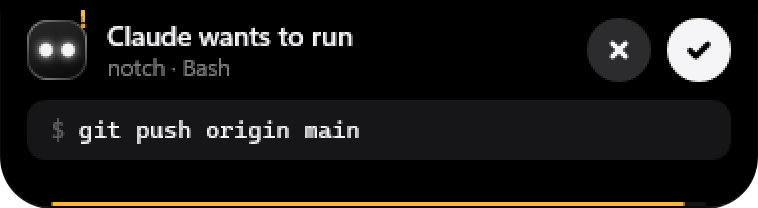

# tini — a notch for Windows

**A tiny dynamic island for Windows.** tini lives at the top edge of your screen as a small black pill: today's tasks, a focus timer, the song that's playing, your own Stream Deck-style shortcuts, and a live view of what your AI agent is doing, with permission prompts and questions you answer right from the notch.

  

## Launching October 30

The first release goes out on **October 30, 2026 at 19:00 WIB (12:00 UTC)**.

To get notified: click **Watch → Custom → Releases** at the top of this page. You can also follow [@iamsetiaji_ on Threads](https://www.threads.net/@iamsetiaji_) for the build story.

Website: https://dimas3007.github.io/tini/

## What's in it

- **Your day:** tasks you type in plain words ("review PR, then team meeting at 2pm tomorrow"), a pomodoro timer, music controls, and smart chips for screenshots and downloads.
- **Your agent:** Claude Code's live activity, permission cards with ✕ / ✓, and questions as buttons. Through MCP, Codex, Gemini CLI or any MCP agent can notify you and ask you too.
- **Your shortcuts:** a Stream Deck-style grid; drag any app onto the notch to add it.
- **Light:** native Rust on Win32 and Windows.UI.Composition, under 15 MB of RAM in daily use, 0% CPU when idle. No account, no telemetry.

  

The source code is published here on launch day.

## License

tini is free and open source under **MIT OR Apache-2.0**, at your choice. Everything in this repository stays free; a possible Pro version later would only add new features.

tini is an independent project, not affiliated with Microsoft, Apple, Anthropic, OpenAI or Google. It is unrelated to [krallin/tini](https://github.com/krallin/tini), the init process for containers.
