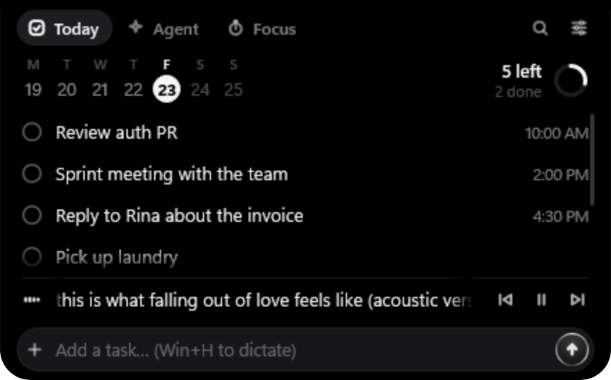
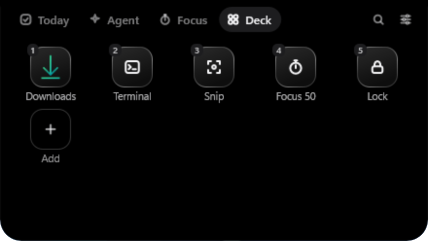

# tini

**A tiny dynamic island for Windows.** tini lives at the top edge of your screen as a small black pill: today's tasks, a focus timer, the song that's playing, your own Stream Deck-style shortcuts, and a live view of what your AI coding agent is doing, with permission prompts and questions you can answer right from the notch.

It is a native Rust app (Win32 + Windows.UI.Composition, Direct2D/DirectWrite for text). Animations run in DWM, nothing polls, and it idles at about 6–8 MB of private memory and 0% CPU.

**Free and open source, for good.** Everything in this repository is MIT OR Apache-2.0 and stays free. A paid tini Pro may come later, but it will only add new features; nothing here will move behind a paywall.

**[Download tini for Windows](https://github.com/dimas3007/tini/releases/latest/download/tini-setup.zip)** · [All releases](https://github.com/dimas3007/tini/releases) · [Discussions](https://github.com/dimas3007/tini/discussions)

> The project was developed under the name *Notch*, so the binaries are still called `notch.exe` and `notch-bridge.exe`, and settings live in `%APPDATA%\Notch`.

| | |
|---|---|
|  |  |
|  |  |

## Features

- **Today.** Local tasks, no account needed. Type in plain language ("review PR, then team meeting at 2pm tomorrow") and tini splits it into tasks with times; English and Indonesian phrases are understood, no AI involved. Overdue tasks turn amber, and a reminder appears ten minutes before a task's time. **Ctrl+Alt+T** adds a task; the input is a standard Windows edit control, so **Win+H** dictation works. Click a date in the week strip to see that day ("Wed, Oct 28 · 3 done · 1 open"); ‹ › or the mouse wheel moves between weeks. Completed tasks are kept for 60 days.
- **Focus.** A pomodoro timer (25 / 5 / 15 minutes, long break every 4 sessions, all adjustable right in the Focus tab). **Ctrl+Alt+P** starts, pauses and resumes. The pill shows a small progress ring and the minutes left.
- **Widgets.** Optional cards in their own tab, each switched on or off in Settings → Widgets:
  - *Prayer times*, calculated offline on your PC with the Kemenag RI method (within ±1 minute of the official Indonesian schedule), for one of ~95 built-in cities (`city bandung` in the command bar) or your position via *Use my location*. A glance 10 minutes before each prayer; at the time, a reminder that stays on screen with a gently rocking moon and a **Done** button (it closes itself after 15 minutes), with a chime or the full adhan.
  - *Clipboard history*: the last three copied texts, in memory only; click one to copy it again.
- **Sounds.** Short, soft chimes synthesized in memory (no sound files) for prayer times, finished focus sessions and timers, and the end of a break. One switch in Settings turns them all off.
- **Music.** Reads Windows' own media controls, so it works with Spotify, browsers (YouTube, YouTube Music), Media Player and any app that registers a media session. An equalizer shows in the pill while music plays; hover for artist, title and prev / play-pause / next.
- **Command bar.** **Ctrl+Alt+N** opens a launcher: apps and folders from the Start Menu, timers (`25m review PR`), calculations (`1250000 * 12 * 11%`), `claude <request>` to start a new Claude Code session in your last repo, `g <query>` to search the web, and anything else becomes a task.
- **Deck.** Your own buttons, like a Stream Deck: open an app, file, folder or link; send a key combination to the previous app; run a PowerShell command; type a snippet; start a focus session. **Ctrl+Alt+1…0** runs the first ten without opening tini. Drag an app, file, folder or link onto the notch to add it.
- **Smart chips.** When you copy a link or an image (Win+Shift+S), or a download finishes, the pill briefly offers one next step: open, save as PNG, add as a task, show in folder. Clipboard content marked private by password managers is never read.
- **Claude Code.** With the hooks installed, tini shows what Claude is doing ("Editing auth.ts", "Running cargo test"), a "Claude finished" chip with a Review button, and cards for permission requests, `AskUserQuestion` questions (radio buttons, or checkboxes for multi-select) and plan approval that you can answer in the notch. Card text is never cut off: cards grow with their content up to 300 px, then scroll. tini never approves anything on its own; unanswered cards go back to Claude's own dialog. The Agent tab lists sessions and context usage, and, if you turn on **Claude usage**, your Claude 5-hour and weekly quota (off by default). While it has no sessions yet, the Agent tab shows "Connect an agent": logo buttons for Claude Code, the Claude app, Codex (OpenAI logo), Antigravity and VS Code, each with its name below (only agents that are installed but not connected yet), then **Show Claude usage** and **Show Codex usage**. The Codex quota (**Codex usage**, off until you turn it on) comes from Codex's own session logs; Antigravity and VS Code keep no quota locally, so they have no meter.
- **MCP server.** `notch-bridge mcp` lets any MCP-capable agent (Claude Code, the Claude app, Codex, Antigravity, VS Code, …) notify you, ask a multiple-choice question, request approval, report progress, add or complete tasks, and read your status (local time, focus timer, screen locked, today's tasks). Connect each one with a switch in Settings → Agents; activity from agents other than Claude Code shows up as its own row in the Agent tab.
- **Nochi.** A pair of glowing eyes that live in the notch: they blink, follow your cursor, read along while an agent works, squint calmly during focus, and jump when you finish something.
- **Polite by default.** Three sizes at rest (Shy: just Nochi's eyes, Compact, or Full), a peek when a maximized window covers the notch, hidden in fullscreen apps and presentations, stays on one monitor (drag it sideways to move it), and per-monitor DPI. Every setting explains itself in a tooltip.

## Requirements

Windows 11 (64-bit). Windows 10 (1809 or later) may work but is not tested.

## Install

1. Download **[tini-setup.zip](https://github.com/dimas3007/tini/releases/latest/download/tini-setup.zip)**, extract it and run `tini-setup.exe`.
2. The installer needs no admin rights. It installs tini for your user to `%LOCALAPPDATA%\Programs\tini`, adds a Start Menu shortcut, and starts tini with Windows (you can untick that).
3. To update, run the newer installer: it closes tini, replaces the program and keeps your tasks and settings. The install folder never changes, so Claude Code hooks and MCP registrations keep working.

**SmartScreen.** tini isn't code-signed yet, so Windows may say "Windows protected your PC". Choose **More info → Run anyway**. Each release lists SHA-256 hashes, a VirusTotal link and GitHub build provenance so you can check the file first.

Prefer no installer? `tini-portable.zip` on the [Releases](https://github.com/dimas3007/tini/releases) page has the same files; keep `notch.exe`, `notch-bridge.exe` and `adhan.mp3` together in a permanent folder.

Click the notch (or the tray icon) to open the panel; the slider button in the panel's top-right corner opens Settings.

## Connecting agents

tini can show what your AI agents are doing and let them reach you: a note when a long task is done, a quick question, an approval before something risky. This section explains how that works for each agent and how to set it up.

### How it works

- tini ships a small local MCP server: `notch-bridge.exe mcp`, which talks over stdio. It has no extra background process; it only runs while an agent runs it.
- **Connect** adds a single `notch` entry to the agent's own MCP config file. Every other entry is left alone, and the original file is backed up once to `<file>.notch-backup`.
- The agent then starts `notch-bridge.exe` itself and gets seven tools: `notify`, `ask_user`, `request_approval`, `progress`, `add_task`, `complete_task` and `get_status`. The bridge forwards each call over a local named pipe to the running tini and returns the answer.
- It works in one direction only. The agent calls tini; tini can't control the agent or read its conversation. The agent's model decides when to call a tool.
- Restart the agent after connecting so it loads the new server. VS Code picks it up without a restart.
- **Claude Code** gets more: tini also installs hooks there, so the notch shows its activity step by step and can answer its permission prompts and questions. Only Claude Code has hooks; other agents only show what their model chooses to send.

### Supported agents

| Agent | What you get | Config file | Entry | Restart |
|---|---|---|---|---|
| **Claude Code** | Live step-by-step activity, "Claude finished" chip, permission cards, `AskUserQuestion` and plan cards (hooks), plus the MCP tools | Hooks and status line in `~/.claude/settings.json`; MCP server via `claude mcp add --scope user` (stored in `~/.claude.json`) | `hooks`, `statusLine`; MCP server `notch` | New sessions pick it up |
| **Claude app** (desktop) | MCP tools in Chat | `claude_desktop_config.json` (Store version: `%LOCALAPPDATA%\Claude-Data\claude_*`; classic: `%APPDATA%\Claude`) | `mcpServers.notch` | Yes |
| **Codex** (app, CLI and IDE extension share one file) | MCP tools | `~/.codex/config.toml` (or under `CODEX_HOME`) | `[mcp_servers.notch]` table; a `notch` table you wrote yourself is not overwritten | Yes |
| **Antigravity** | MCP tools | `~/.gemini/antigravity/mcp_config.json` | `mcpServers.notch` | Yes |
| **VS Code** (Copilot agent mode) | MCP tools | `%APPDATA%\Code\User\mcp.json` | `servers.notch` with `"type": "stdio"` | No |

What each tool does:

| Tool | In the notch | Returned to the agent |
|---|---|---|
| `notify` | A chip with the agent's name and your message | "Shown in the notch." (or why not: panel open, card showing, fullscreen) |
| `ask_user` | A question card with 2–4 options (radio buttons; with `multi`, checkboxes and Done), 100 s | The chosen option(s), comma-separated, or "did not answer, ask in the conversation" |
| `request_approval` | A "needs your OK" card with ✕ / ✓, 100 s | Approved / Declined / No answer (the agent is told not to proceed unless approved) |
| `progress` | Claude Code: replaces "Thinking…" in the live view ("Migrating · 40%"). Other agents: their own row in the Agent tab and live view ("Claude app · Drafting · 40%") | Confirmation |
| `add_task` | Natural language, like the task input ("review PR tomorrow at 10") | The task that was added |
| `complete_task` | Checks off today's open task with a matching title | The completed task, or no match |
| `get_status` | — | Local time and day, screen locked or not, focus timer, today's tasks |

Agents can't answer their own cards, create Deck buttons, or read your clipboard or screenshots. tini never approves anything on its own: an unanswered permission card goes back to the agent's own dialog.

### Where to connect

- **Settings → Agents** has a switch for each agent. Turning a switch off removes the `notch` entry again.
- The **empty Agent tab** shows a logo button for each agent that is installed but not connected yet. One click connects it.
- tini detects whether an agent is installed from its data folder. Agents that aren't installed show dimmed as "(not installed)" and can't be clicked.

### Manual setup

The installer puts the bridge at `%LOCALAPPDATA%\Programs\tini\notch-bridge.exe`; use your own path for a portable copy.

```powershell
# Claude app, Codex, Antigravity or VS Code (uninstall-mcp removes it again)
.\notch-bridge.exe install-mcp claude-app
.\notch-bridge.exe install-mcp codex
.\notch-bridge.exe install-mcp antigravity
.\notch-bridge.exe install-mcp vscode

# Claude Code: hooks and status line, then the MCP server
.\notch-bridge.exe install
claude mcp add --scope user notch -- "C:\path\to\notch-bridge.exe" mcp
```

`.\notch-bridge.exe install` takes another settings file path as an argument if you want to target one. It keeps your other settings and hooks, backs up the original once to `settings.json.notch-backup`, and leaves an existing custom `statusLine` alone. When tini isn't running, the hook exits within about 50 ms without output, so Claude Code isn't slowed down. `install-chat` / `uninstall-chat` still work as aliases for the Claude app.

If a config file contains comments (JSONC), tini won't edit it, so your comments are never lost. Use Copy setup (below) and paste the entry yourself.

### Other agents (manual setup)

Any app that can run a local (stdio) MCP server can use tini. It just has no switch in Settings. To add one:

1. Click **Settings → Agents → Other MCP apps → Copy setup**. This copies the entry with the right path to `notch-bridge.exe`:

   ```json
   {"mcpServers":{"notch":{"command":"C:\\path\\to\\notch-bridge.exe","args":["mcp"]}}}
   ```

2. Paste it into that app's MCP config, under the key that app uses.
3. Restart the app.

| App | Config file | Key |
|---|---|---|
| Gemini CLI | `~/.gemini/settings.json` | `mcpServers` |
| Cursor | `~/.cursor/mcp.json` (or `.cursor/mcp.json` in a project) | `mcpServers` |
| Windsurf | `~/.codeium/windsurf/mcp_config.json` | `mcpServers` |
| Claude Code, one project only | `.mcp.json` in the project | `mcpServers` |
| Anything else | see the app's MCP docs | usually `mcpServers` (VS Code-style apps use `servers`) |

- These agents get the MCP tools only. Hooks are Claude Code only.
- The Agent tab shows each agent by the name it reports, for example "Gemini" or "Cursor", or the raw client name for apps tini doesn't know.
- The uninstaller doesn't know about entries you added by hand. Remove them yourself after uninstalling; otherwise the app will show that the `notch` server failed to start.

### Usage meters

Both meters are off until you turn them on in Settings → Agents (or with the buttons in the empty Agent tab).

- **Claude usage** shows Claude's official 5-hour and weekly limits. It reads the Claude Code login token, talks only to Anthropic, and refreshes the token when it has expired (details under [Privacy](#privacy)).
- **Codex usage** reads the `rate_limits` that Codex writes to its own session logs in `~/.codex/sessions`. No login and no network, so the numbers only update each time you use Codex.
- Other agents keep their quota on their servers, so they have no meter.

### What can't connect, and why

ChatGPT, claude.ai on the web and the mobile apps only support *remote* MCP servers, reached over a URL. Those connections are made from the vendor's servers, which can't reach an app running locally on your PC. tini deliberately has no internet-facing server.

### Troubleshooting

- **The agent doesn't see the tools:** restart the agent, then check that its config file (table above) contains a `notch` entry.
- **The tools return an error:** make sure tini is running. Without it, each tool returns a normal error and the agent carries on in the chat.
- **The agent rarely uses tini:** the model decides when to call a tool. Add a line to the agent's rules or instructions, for example: "When you finish a long task, call notch notify."
- **Claude Code shows nothing in the notch:** check that `~/.claude/settings.json` contains `notch-bridge` (the Claude Code switch in Settings → Agents).

### Uninstalling

The uninstaller removes every hook and MCP entry that points at tini, in every agent above, before it deletes the program. It only touches config files that actually mention tini.

## Command line

Arguments are forwarded to the running instance:

```powershell
notch.exe --toggle                   # open / close the panel
notch.exe --add "review PR, then team meeting at 2pm"
notch.exe --glance "Build finished in 42 s"
notch.exe --command "25m review PR"  # open the command bar with this text
notch.exe --deck                     # open the Deck tab
notch.exe --focus                    # start / pause / resume the focus timer
notch.exe --focus-stop
notch.exe --autostart on             # or off
```

Hotkeys: **Ctrl+Alt+N** command bar, **Ctrl+Alt+T** add a task, **Ctrl+Alt+P** focus timer, **Ctrl+Alt+1…0** Deck buttons. **Esc** or a click outside closes the panel.

## Privacy

tini is local-first. It has no account, no telemetry and no update check.

- **Your data stays on your PC.** Tasks, Deck buttons and settings are plain files in `%APPDATA%\Notch` (`tasks.json`, `deck.json`, `settings.ini`).
- **Claude quota (opt-in, off by default).** Until you turn on **Claude usage** (the *Show Claude usage* button in the empty Agent tab, or Settings → Agents), tini never reads your Claude Code login and makes no network requests at all. Once it's on, to show the official 5-hour and weekly limits tini reads Claude Code's login token from `~/.claude/.credentials.json` into memory and sends it only to `api.anthropic.com` (the same usage endpoint `/usage` in Claude Code uses), at most every 5 minutes while agents are active and every minute while the Agent tab is open. The token is never logged. Turning it off stops all of this.
  - **Token refresh.** The Claude desktop app doesn't refresh that file, so when the token has expired tini refreshes it the way Claude Code does: it takes Claude Code's own refresh lock (`~/.claude/.oauth_refresh.lock`), re-reads the file, exchanges the refresh token at `platform.claude.com`, and writes the new tokens back to `.credentials.json` atomically. A rejected refresh token is not retried.
  - The usage endpoint is undocumented, so if it fails the meters show the last known values. Apart from these two Anthropic hosts, nothing leaves your machine.
- **Codex quota (opt-in, off by default).** With **Codex usage** on, tini reads only the `rate_limits` lines that Codex itself writes to its local session logs (`~/.codex/sessions/**/rollout-*.jsonl`, or under `CODEX_HOME`). No login token, no network.
- **Location.** Prayer times are computed locally, with no internet. *Use my location* asks Windows Location for your position once, only when you click it; the coordinates are stored only in `settings.ini` and never sent anywhere.
- **Clipboard.** Clipboard history lives in memory only and is gone when tini quits. Otherwise the clipboard is read only when the content is a link or an image, never when the copying app marks it private (`ExcludeClipboardContentFromMonitorProcessing`, used by password managers) or excluded from clipboard history, and not at all when Smart chips are off. A copied image is held in memory only while its chip is showing.
- **Claude Code hooks** send a short summary of each event (tool, file name, project folder, prompt) over a local named pipe that only your Windows user can open (`\\.\pipe\notch-agent-<your SID>`), never over the network.
- **Greeting.** The morning greeting uses the first part of your Windows user name.

## Uninstall

Open **Settings → Apps → Installed apps**, find **tini** and choose *Uninstall*. The uninstaller:

- closes tini;
- removes its Claude Code hooks and status line (`notch-bridge uninstall`), the `notch` MCP server from Claude Code (if the `claude` CLI is available), and its MCP entries for the Claude app, Codex, Antigravity and VS Code (`notch-bridge uninstall-mcp <app>`), so nothing keeps pointing at a deleted exe. Only configs that actually mention tini are touched;
- removes the Start Menu shortcut and the *Start with Windows* entry;
- asks whether to delete your tasks, Deck and settings in `%APPDATA%\Notch` (kept unless you say yes).

Portable copy: turn off every agent in Settings → Agents (or run `notch-bridge.exe uninstall`, `claude mcp remove notch -s user` and `notch-bridge.exe uninstall-mcp <app>` for each app you connected), `notch.exe --autostart off`, choose *Quit* in the tray menu, then delete the folder (and `%APPDATA%\Notch` if you like).

## Build from source

You need [Rust](https://rustup.rs) on Windows. The default toolchain (`stable-x86_64-pc-windows-msvc`, with Visual Studio Build Tools and the "Desktop development with C++" workload) works out of the box:

```powershell
cargo build --release
cargo test
.\target\release\notch.exe
```

The binaries end up in `target\release\` (`notch.exe`, `notch-bridge.exe`). A debug build (`cargo build`) opens a console window with an event log. To build the installer as well, install [Inno Setup 6](https://jrsoftware.org/isinfo.php) and run `iscc installer\tini.iss` (output: `dist\tini-setup.exe`).

<details>
<summary>Using the GNU toolchain instead (no Visual Studio)</summary>

`x86_64-pc-windows-gnu` works too, with two extra requirements: a GNU `dlltool` with `as` on `PATH` (the `windows` crate uses `raw-dylib`, and rustup's bundled dlltool has no assembler), and a build directory without spaces in its path. With [MSYS2](https://www.msys2.org):

```powershell
pacman -S mingw-w64-x86_64-binutils            # in an MSYS2 shell
$env:NOTCH_DLLTOOL_DIR = 'C:\msys64\mingw64\bin'
.\cargo-env.ps1 build --release
.\cargo-env.ps1 test
```

`cargo-env.ps1` puts that folder on `PATH`, moves the target directory to `%LOCALAPPDATA%\notch-target` when the repo path contains a space (or uses `CARGO_TARGET_DIR` if set), and reads machine-specific settings from an optional, gitignored `cargo-env.local.ps1`. Don't put a whole MinGW `bin` folder on `PATH` if its `gcc` lacks `libgcc_eh`; a folder with just `dlltool.exe` and `as.exe` is enough.
</details>

### Project layout

```
crates/app/       notch.exe: window, Composition visuals, panel, tasks, focus, media, command bar, Deck, chips
crates/bridge/    notch-bridge.exe: hook | statusline | mcp | install | uninstall | install-mcp | uninstall-mcp (no `windows` crate, so it starts fast)
crates/protocol/  JSON messages shared by the bridge and the app
installer/        Inno Setup script for the per-user installer
assets/           adhan.mp3 and README screenshots
spike/            Phase 0 comparison of Composition vs. Slint (archived; see spike/results.md)
```

Pure logic (sentence parser, view-state rules, geometry, springs, pomodoro, Deck, agent sessions, bridge install) has unit tests; `cargo test` runs them all.

## Performance

Release build on a Core i3-10105F with an NVIDIA GPU, measured with an empty task list. "Private working set" is the Memory column in Task Manager.

| | Private working set | Private bytes | Threads | CPU |
|---|---|---|---|---|
| Idle, just started | 5.6–6.8 MB | 10–13 MB | 19 | 0% |
| After opening and closing the panel | 8.0 MB | 14–16 MB | 15–19 | 0% |
| Busy (toggle or glance every 1.3 s) | 7.9–8.6 MB | 14–15 MB | 20–22 | 0.7–0.9% of one core |

Surfaces are drawn with a WARP (CPU) Direct3D device rather than the GPU, which keeps the graphics driver out of the process (about 14 MB instead of 56 MB of private bytes) at the same per-frame cost; animations still run in DWM.

## Known gaps

Hotkeys, hover, mouse wheel, Win+H dictation and the tray menu need real input and are tested by hand. The hooks were tested with real `claude -p` sessions; the permission flow was tested with officially formatted `PermissionRequest` payloads but not yet against Claude's real permission dialog. Answering MCP cards by clicking has not been automated.

## Community and contributing

Questions, ideas and Deck setups go to [Discussions](https://github.com/dimas3007/tini/discussions); bugs and concrete feature requests to [Issues](https://github.com/dimas3007/tini/issues). Pull requests are welcome; see [CONTRIBUTING.md](CONTRIBUTING.md). If tini is useful to you, you can support it through the Sponsor button on GitHub.

## License

Licensed under either of [Apache License, Version 2.0](LICENSE-APACHE) or [MIT license](LICENSE-MIT) at your option.

Unless you explicitly state otherwise, any contribution intentionally submitted for inclusion in this project by you, as defined in the Apache-2.0 license, shall be dual licensed as above, without any additional terms or conditions.

"tini" and "Nochi" are the project's names; forks need their own name and logo, see [TRADEMARKS.md](TRADEMARKS.md). Brand logos in `crates/app/src/brands.rs` come from [Simple Icons](https://simpleicons.org) (CC0; the VS Code logo from Simple Icons 8.0.0), except the Antigravity mark, which is drawn by hand; the brands themselves belong to their owners. `assets/adhan.mp3` is a public-domain recording by Sabah Fakhri from Wikimedia Commons; see [assets/README.md](assets/README.md).
